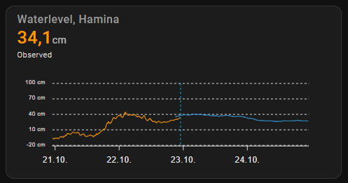

# FMI data for Home Assistant

## What is it?

A custom component that integrates with Finnish Meteorological Institute to retrieve data not typically part of
other weather integrations, such as seawater level, UV-index, snow thickness etc. Radiation data published by
STUK through the same API is also available.

The integration is added once. Each sensor you then add to it is one parameter from one observation station or
forecast point.

It can also follow FMI's weather warnings for a place, with a sensor for the warning level in force and an event
entity for automations. See [Weather warnings](#weather-warnings).

## Installation

### With HACS

1. Add this repository to HACS custom repositories
2. Search for FMI in HACS and install with type integration
3. Restart Home Assistant
4. Add the integration from the settings/integrations page of Home Assistant

### Manual

1. Download source code from latest release tag
2. Copy custom_components/fmi folder to your Home Assistant installation's config/custom_components folder.
3. Restart Home Assistant
4. Add the integration from the settings/integrations page of Home Assistant

No account or API key is needed. FMI's open data service is used anonymously.

## Configuration

### Setting up the integration

| Name     | Type | Requirement  | Description                  | Default |
|----------|------|--------------|------------------------------|---------|
| language | enum | **Required** | Language used in API calls   | `eng`   |

The language affects the query titles and parameter descriptions returned by FMI, and the language of warning
texts. It is the language of the sensors and warnings places added from then on; each keeps the language it was
added with. Change it with **Reconfigure** on the integration.

Then add sensors with **Add sensor**, and places to follow weather warnings for with **Add warnings place**, on the
integration's page.

## Adding a sensor

The wizard discovers what is available at each step, so you do not need to look anything up by hand.

### Step 1 - query

| Name        | Type | Requirement  | Description                                  | Default |
|-------------|------|--------------|----------------------------------------------|---------|
| query_label | enum | **Required** | Query type, listed from FMI's stored queries |         |

### Step 2 - location

| Name   | Type | Requirement  | Description                  | Default |
|--------|------|--------------|------------------------------|---------|
| target | enum | **Required** | Observation station or place |         |

For observation queries, only the stations that actually serve the query you chose are offered, so you cannot
pick one that will never return data for it. Forecast queries are interpolated to a point rather than tied to a
station, so all stations are offered for those. Either way they are ordered by distance from your Home
Assistant location:

```
Helsinki Mannerheimintie (100742) - 0 km
Helsinki Kaisaniemi (100971) - 1 km
Helsinki Katajanokka 2 (104053) - 2 km
```

You can also type a place name, or coordinates as `latitude,longitude`. The identifier type is worked out from
what you enter, so there is nothing to choose: digits are treated as an FMISID, a pair of numbers as
coordinates, and anything else as a place name. This works for STUK queries too, which have their own stations.


### Step 3 - parameter

| Name                | Type   | Requirement  | Description                                                               | Default |
|---------------------|--------|--------------|---------------------------------------------------------------------------|---------|
| parameter           | enum   | **Required** | Which parameter from the query data to use                                |         |
| negative_as_zero    | bool   | **Required** | Report -1 as 0                                                            | `false` |
| forecast_step       | int    | **Required** | Step between two values in minutes. Only shown for forecast type queries. | 30      |
| forecast_hours      | int    | **Required** | How many hours of forecasts to retrieve (starting from current time)      | 36      |
| forecast_past_hours | int    | **Required** | How many past hours of forecasts to retrieve (starting from current time) | 5       |

Only the parameters the chosen station actually reports are offered, with their descriptions and units:

```
rrday - Precipitation amount (mm)
tday - Air temperature (°C)
TG_PT12H_min - Ground minimum temperature (°C)
```

If a parameter you need is missing from the list you can still type its name.

Some parameters use `-1` to mean "no measurable value" rather than `0`. Daily precipitation is the common
case: a dry day reads `-1`, which distorts graphs and long term statistics. Enable **negative_as_zero** to
report those as `0`. Only exactly `-1` is affected, so a genuine `-1` degree temperature is left alone.

### Step 4 - name

| Name  | Type   | Requirement  | Description                                 | Default                     |
|-------|--------|--------------|---------------------------------------------|-----------------------------|
| label | string | **Required** | Name for the created sensor                 | station and parameter names |

A name is suggested from your choices, for example `Helsinki Kaisaniemi Air temperature`. The sensor can be
renamed later without losing its history.

## Changing a sensor later

Use **Change sensor** from the sensor's menu on the integration page to point an existing sensor at a different
query, station or parameter, and to change the -1 handling and forecast settings. The entity keeps its identity
and history, so this is the way to repair a sensor whose station has been decommissioned or whose parameter is no
longer published.

To rename a sensor, use Home Assistant's own entity settings. The name is not part of the sensor's identity, so
renaming does not affect its history.

## Changes in 3.0

- The integration is added once, and sensors and warnings places are added to it, instead of every sensor being
  an integration entry of its own.
- The stale data settings are shared by every sensor, under **Configure** on the integration.
- Daily, monthly and yearly statistics are given a whole reporting period before their data counts as stale.
- Warnings places share one download of FMI's warning feed.

## Upgrading from 2.x

The existing entries are merged into one on the first start after the update: each becomes a sensor or warnings
place of the one FMI entry. Entity IDs do not change, so history, statistics, dashboards and automations keep
working, and entities you had disabled stay disabled. Nothing needs to be reconfigured.

The stale data settings most of your sensors had become the shared setting. Sensors that were set up before the
setting existed used 24 hours, and use the shared setting from now on.

Downgrading to 2.x after the merge is not supported: restore a backup instead.

## Changes in 2.1

- Weather warnings for a place: a warning level sensor and an event entity for automations.
- A diagnostic stale data binary sensor for every observation and forecast sensor.
- The no-data repair issue can be made more or less patient with **no_data_issue_hours**, or switched off.

## Upgrading from 1.x

Version 2 stops identifying sensors by their name, so that they can be renamed and repointed. Entries from 1.x
are migrated automatically on first start and keep their entities, history and statistics. Nothing needs to be
reconfigured.

## When a station or parameter stops working

FMI removes parameters from stations, and stations are occasionally decommissioned or renumbered. Neither shows
up as an error: the query simply returns nothing.

When the newest value FMI holds for a sensor is more than **no_data_issue_hours** old (24 hours by default),
the integration reports a repair issue in Home Assistant telling you whether the station returns nothing at
all, or whether it is still reporting but no longer publishes your parameter, in which case the parameters it
does publish are listed. Use **Change sensor** to move the sensor to a working station or parameter, and the
issue clears itself.

| Name                | Type | Description                                                  | Default |
|---------------------|------|--------------------------------------------------------------|---------|
| no_data_issue       | bool | Report a repair issue when a sensor stops getting data       | `true`  |
| no_data_issue_hours | int  | How many hours without data before the data counts as stale  | 24      |

Both are under **Configure** on the integration, and apply to every sensor. Stations do go quiet for a while
without being broken, so the delay is deliberately generous. Shorten it if you want to hear about outages sooner,
or turn **no_data_issue** off to rely on the stale data sensors alone.

Daily, monthly and yearly statistics are published only once the day, month or year is over, so their newest
value can legitimately be a whole period old. For those the limit is never shorter than three days, 62 days or
two years, whatever the setting.

The age is read from FMI's own timestamp on the data, not from how long Home Assistant has been seeing empty
updates. That matters in two ways. Restarting Home Assistant does not put the clock back to zero, so a sensor
on a box that reboots nightly is still noticed. And because each query type looks back over a different window
- twelve hours for the plain observation queries, two days for the daily ones, two years for the yearly ones -
a station that had gone quiet used to keep returning its last value for the length of that window before it
even looked empty. The setting now means the age of the data, whatever the query.

### Stale data sensor

Every observation and forecast sensor also has a diagnostic binary sensor, for example
`binary_sensor.fmi_helsinki_kaisaniemi_air_temperature_stale_data` (`..._vanhentunut_data` with Finnish as the
language). It is on while the newest data is older than the limit above, and turns off by itself when data comes
back. The repair issue is for you to notice; the binary sensor is for automations. It works whether or not the
repair issue is enabled.

## Weather warnings

FMI issues weather warnings for land and sea areas up to five days ahead. A warnings place follows them for one
place: choose **Add warnings place** on the integration page.

| Name          | Type     | Requirement  | Description                               | Default                   |
|---------------|----------|--------------|-------------------------------------------|---------------------------|
| location      | map      | **Required** | The place, and a radius around it         | Home, 1 km                |
| warning_types | list     | **Required** | Which warning types to follow             | All                       |
| label         | string   | **Required** | Name for the sensor and the event entity  | `Warnings`/`Varoitukset`  |

A warning is included when one of its areas covers the place, or comes within the radius of it. Warning areas are
the municipalities for warnings on land and the sea areas for warnings at sea. A sea area includes the islands in
it, so a place on an island gets the warnings for its sea area. On the shore, a radius of a kilometre or two brings
in the nearby sea area.

The warning types are wind on land and at sea, severe thunderstorms on land and at sea, heavy rain, traffic weather,
pedestrian weather, wildfire, heat wave, cold, UV, wave height, sea level and ice accretion.

Use **Change warnings place** to move the place or change the radius, the warning types or the name.

The warnings come from FMI's open [CAP warning feed](https://alerts.fmi.fi/cap/feed/atom_fi-FI.xml), read every
ten minutes.

### Warning level sensor

The state is the highest warning level in force now: `none`, `yellow`, `orange` or `red`.

| Name            | Type        | Description                                                                  |
|-----------------|-------------|------------------------------------------------------------------------------|
| label           | string      | Name given to the place                                                      |
| language        | string      | Language of the warning texts                                                |
| latitude        | float       | Latitude of the place                                                        |
| longitude       | float       | Longitude of the place                                                       |
| radius          | float       | Radius around the place in metres                                            |
| warning_types   | list        | The warning types followed                                                   |
| active_warnings | int         | Number of warnings in force now                                              |
| warnings        | [warning]   | Every warning that concerns the place, in force or coming up, earliest first |

Only the level is recorded in history; the `warnings` attribute is not.

Each warning, in the `warnings` attribute and in the events below, has these fields:

| Name        | Type     | Description                                                                         |
|-------------|----------|-------------------------------------------------------------------------------------|
| id          | string   | FMI's identifier for this version of the warning                                    |
| type        | string   | Warning type, e.g. `seaWind` or `seaWaveHeight`                                     |
| level       | string   | `yellow`, `orange` or `red`                                                         |
| event       | string   | Name of the warning, e.g. `Tuulivaroitus merelle`                                   |
| severity    | string   | `Moderate`, `Severe` or `Extreme`                                                   |
| onset       | datetime | When the warning comes into force                                                   |
| expires     | datetime | When it ends                                                                        |
| headline    | string   | FMI's headline                                                                      |
| description | string   | FMI's description                                                                   |
| impacts     | string   | Typical impacts, e.g. `Mahdollisesti vaarallinen huviveneille.`                     |
| probability | int      | Probability in percent, when FMI gives one                                          |
| areas       | list     | The warning's areas that concern the place                                          |
| parameters  | object   | Values for the warning type, e.g. `windIntensity: 14`, `windIntensityUom: m/s`, `windDirection: 180`, `waveHeight` |

### Warning events

The event entity fires when something happens to a warning that concerns the place:

| Event type  | When                                                                  |
|-------------|-----------------------------------------------------------------------|
| `issued`    | A new warning concerns the place                                      |
| `updated`   | A warning's level, validity, texts or values changed                  |
| `cancelled` | A warning was withdrawn before it expired                             |

The event data is the warning, with the fields above. FMI republishes its warnings regularly; a warning republished
without changes fires nothing. A warning coming into force or running out changes the level sensor instead, and
warnings already in force when Home Assistant starts do not fire `issued`.

For example, a notification when a warning is issued for the cabin:

```yaml
triggers:
  - trigger: state
    entity_id: event.fmi_warnings_cabin
    not_from: unavailable
conditions:
  - condition: state
    entity_id: event.fmi_warnings_cabin
    attribute: event_type
    state: issued
actions:
  - action: notify.mobile_app_phone
    data:
      title: "{{ trigger.to_state.attributes.headline }}"
      message: "{{ trigger.to_state.attributes.description }}"
```

## State attributes

All sensors return the following extra attributes.

| Name          | Type   | Description                                                 |
|---------------|--------|-------------------------------------------------------------|
| latitude      | float  | Latitude of the observation station                         |
| longitude     | float  | Longitude of the observation station                        |
| label         | string | Name given to the sensor                                    |
| language      | string | Language used in API calls                                  |
| query_id      | string | Query ID set when configuring the sensor                    |
| query_name    | string | Human readable name of the query                            |
| parameter     | string | Name of the returned parameter                              |
| location_type | string | Type of identifier used (fmisid/place/latlon)                |
| location_id   | string | Identifier value                                            |
| no_data_issue | bool   | Whether the no-data repair issue is enabled                 |
| no_data_issue_hours | int | Hours without data before the data counts as stale, after the minimum for the query type |

Additionally, observation type sensors return the following extra attributes.
Observation type sensors return the latest known value as sensor state.

| Name   | Type     | Description                     |
|--------|----------|---------------------------------|
| time   | datetime | Time of the latest observation  |
| value  | string   | Value of the latest observation |

Additionally, forecast type sensors return the following extra attributes.
Forecast type sensors return the next known forecast value as sensor state.

| Name                | Type             | Description                                                       |
|---------------------|------------------|-------------------------------------------------------------------|
| forecast            | [{date, string}] | List of forecast values as objects containing time and value keys |
| forecast_hours      | int              | Configured number of forecast hours                               |
| forecast_past_hours | int              | Configured number of past forecast hours                          |
| forecast_step       | int              | Configured step between two values in minutes                     |

### Usage with apexcharts-card

One example use case for this integration could be to show waterlevel values with [apexcharts-card](https://github.com/RomRider/apexcharts-card).

Below is an example configuration for showing waterlevels (2 days of observations and 2 days of forecasts, 2 hour overlap).
Same kind of configuration could of course be used for other observation/forecast types aswell.



```
type: custom:apexcharts-card
graph_span: 4d
span:
  offset: +2d
now:
  show: true
header:
  show: true
  title: Waterlevel, Hamina
  show_states: true
  colorize_states: true
all_series_config:
  curve: straight
apex_config:
  chart:
    height: 150px
  legend:
    show: false
  xaxis:
    labels:
      format: dd.MM.
series:
  - entity: sensor.fmi_waterlevel_hamina
    transform: return x/10
    stroke_width: 1
    float_precision: 3
    yaxis_id: waterlevel
    name: Mitattu
    color: orange
    unit: cm
    extend_to: now
  - entity: sensor.fmi_waterlevel_forecast_hamina
    data_generator: |
      return entity.attributes.forecast.map((entry) => {
        return [entry["time"], entry["value"]];
      });
    stroke_width: 1
    float_precision: 3
    yaxis_id: waterlevel
    show:
      in_header: false
yaxis:
  - id: waterlevel
    min: ~-20
    max: ~100
    apex_config:
      tickAmount: 4
      labels:
        style:
          fontSize: 8px
        formatter: |
          EVAL:function(value) {
            return value.toFixed(1) + ' cm'; 
          }
```